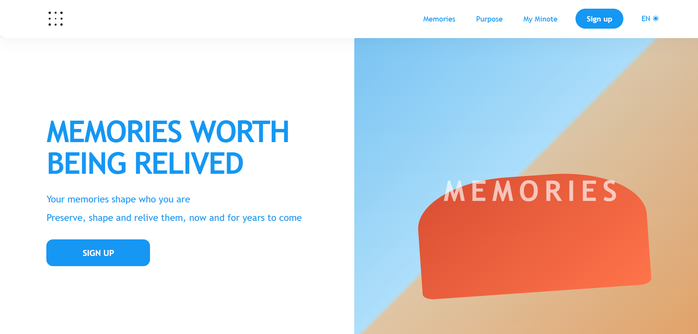
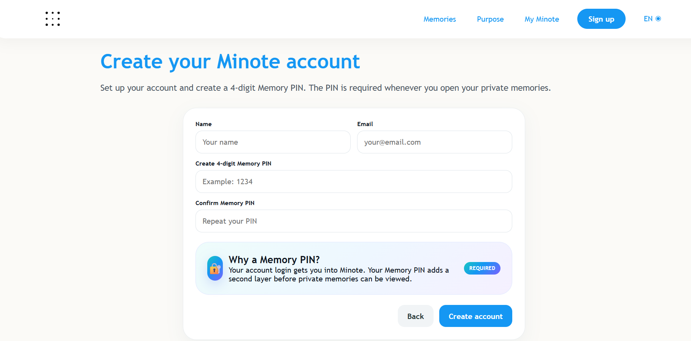
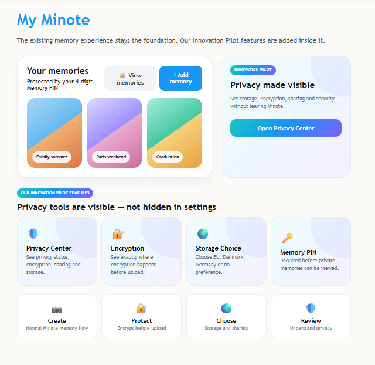
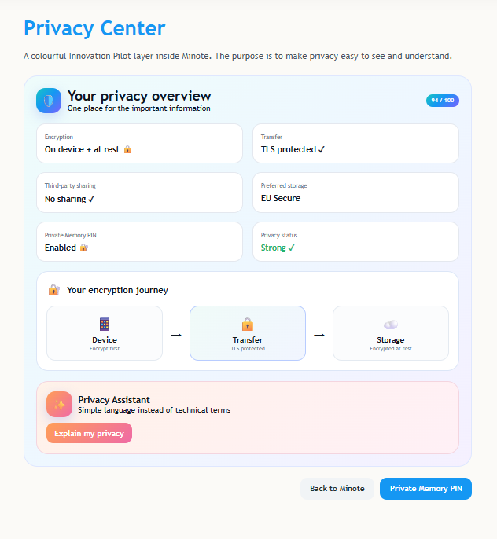
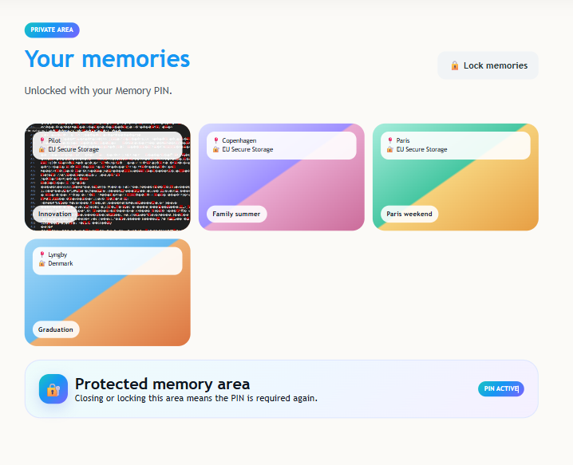
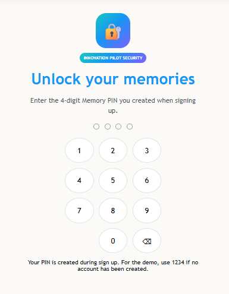

# Minote | Privacy & Security Experience

**Interactive product prototype · DTU Innovation Pilot · Summer 2026**  
**Focus:** Product development · User experience · Privacy by design · Stakeholder communication

> Making privacy understandable and giving people more control over their digital memories.

## Overview

Developed an interactive web prototype for a real-world innovation challenge with **Minote**, a platform focused on personal memories. The concept extends the existing memory experience with visible privacy controls and clearer information about data storage, encryption and sharing.

**Project status:** Interactive concept prototype, not a production-ready application or a validated security system.

## The Challenge

People store highly personal memories online without always knowing where their data is held, who can access it or how it is protected. Our initial focus was storage location. Research and user feedback led us to a broader problem: how to make privacy choices accessible and understandable without complicating the user experience.

## The Prototype

| Feature | What the prototype demonstrates |
| --- | --- |
| Privacy Center | A central place for privacy, storage and sharing information |
| Memory PIN | A four-digit access step for private memories |
| Storage Preferences | The option to express a preferred storage region or no preference |
| Encryption Information | Plain-language explanations of proposed data protection |
| Sharing Controls | Clearer choices concerning third-party sharing |
| Privacy Assistant | Simple explanations of privacy-related settings |

The experience connects these concepts to the existing flow of creating, saving and accessing personal memories rather than introducing a separate platform.

## Product Showcase

A visual walkthrough of the interactive Minote privacy prototype, from account creation to protected memory access.

### 01 / Landing Page

### 02 / Account Creation

Users create an account and configure a four-digit Memory PIN as part of the prototype's onboarding experience.

### 03 / My Minote Dashboard

Privacy features are integrated directly into Minote's existing memory experience.

### 04 / Privacy Center

An accessible overview of proposed encryption, storage and sharing controls.

### 05 / Protected Memories

A dedicated memory area illustrating PIN-controlled access to private content.

### 06 / Memory PIN

A custom PIN entry interface for unlocking private memories within the prototype.

*Security features are demonstrated at prototype level and have not been validated for production use.*

## My Role & Contributions

The Innovation Pilot challenge originally involved a six-person team. Following a team restructuring, the project was completed by **two team members**. I took primary responsibility for developing the interactive web prototype and driving much of the work from research to final delivery.

My responsibilities included:

- Developing the interactive prototype and connecting the new features to Minote's memory flow.
- Creating wireframes, user flows and the overall privacy experience.
- Leading research synthesis, concept development and much of the project coordination.
- Revising the experience following feedback from Minote, especially to integrate it more closely with the existing product.
- Preparing and delivering the final presentation.

Despite the reduced team capacity, we completed the project and achieved a strong academic result.

## Presentation & Industry Feedback

I presented the concept to an audience of **approximately 300 attendees**, including representatives from **Microsoft** and **Minote**. The presentation covered the user problem, research-led design decisions and the interactive prototype.

Feedback from Minote prompted an important design change: instead of appearing as a separate privacy service, the new capabilities became part of Minote's existing memory experience.

## Process

**Discover → Define → Develop → Deliver**

We used research, interviews, problem framing, wireframes, iterative prototyping and feedback to develop the concept. The project reinforced the importance of validating user needs before committing to a solution.

## Scope & Limitations

This repository documents an **innovation and user-interface prototype**. Features such as encryption, secure PIN storage, storage-region enforcement and access-control safeguards are conceptual in this version. They would require backend engineering, security review and validation before production use.

## Project Materials

Prototype screenshots, source files and selected documentation will be added when approved for publication. The project was carried out as a DTU Innovation Pilot collaboration with Minote.

---

**Project lead / prototype development:** Malik Yildirim  
**Project:** DTU Innovation Pilot, Summer 2026
